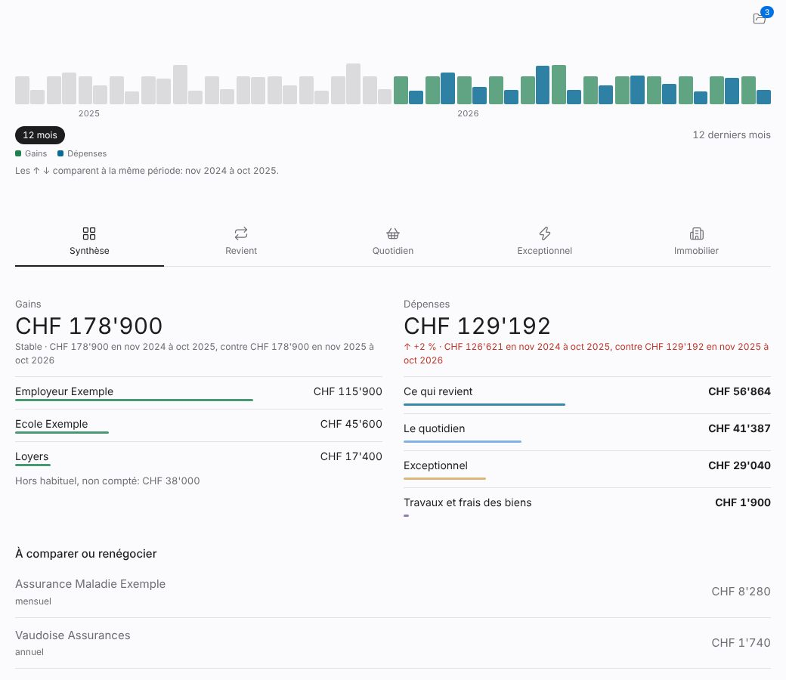
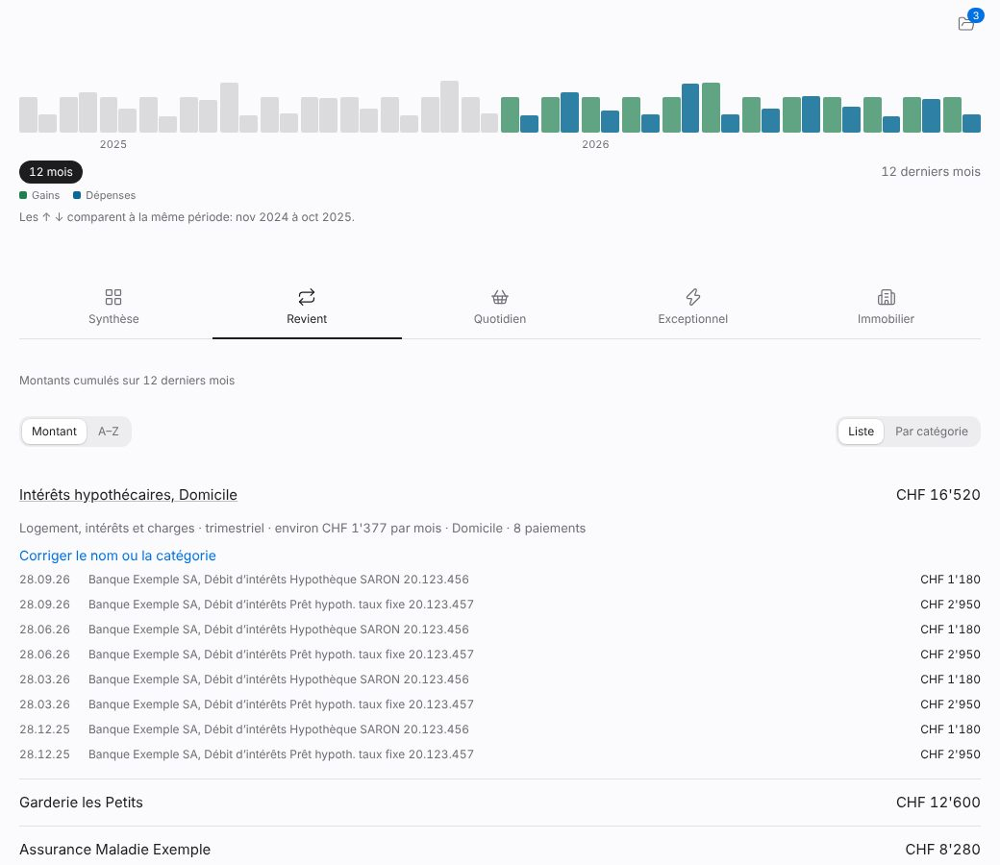
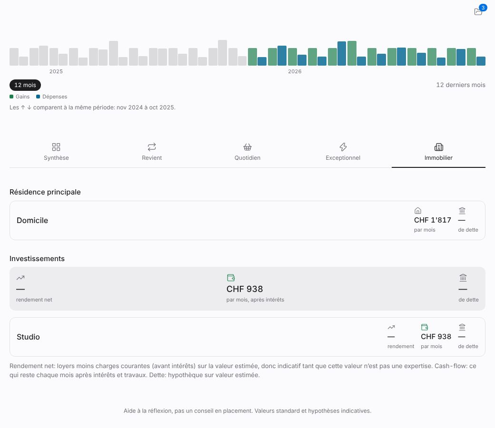

# Horizon

**Dépose tes documents, Horizon en tire ta situation financière réelle.**

Relevés de comptes et de cartes, impôts, hypothèques, contrats: Horizon les lit sur ton ordinateur, masque les noms et les numéros, classe chaque ligne, écarte les doublons et les virements entre tes comptes, puis répond à des questions simples. Combien rentre, combien sort, combien reste, mois par mois et année par année. Et ce qui pèse vraiment: impôts, immobilier bien par bien, assurances, vie courante.

Il contrôle ce qu'il peut: le total imprimé de chaque facture de carte, les virements entre tes comptes, les doublons, et les soldes si tu les donnes. Le but n'est pas de saisir des chiffres à la main. Tu déposes, Horizon lit, tu précises trois informations, tu contrôles.

À terme, ces dépenses réelles alimentent les besoins de retraite et les scénarios (vente d'un bien, hausse des taux, rachats de caisse de pension). Ces modules existent (tag `retraite-v1`) et sont en cours de remise à plat à partir du budget.

Tout reste sur ton ordinateur. Les données personnelles vivent dans `data/` et ne sont jamais versionnées.

## Démarrer

```bash
git clone <adresse du dépôt>
cd horizon
npm install
npm run hooks      # bloque tout commit de données personnelles
npm run dev        # http://127.0.0.1:5173, une famille fictive est chargée
```

Il faut Node 22.5 ou plus (SQLite intégré). Aucun compte, aucun service externe. Sur macOS, la lecture des PDF utilise PDFKit et la reconnaissance optique locale (Swift): rien à installer.

Pour passer à tes données: bouton « Mes données » (silhouette) en haut à droite, puis écran **Budget**: indique le dossier de documents et clique sur « Relire le dossier ».

## Le principe en quatre étapes

| Étape | Ce qui se passe |
|---|---|
| 1. Déposer | tu mets tes documents dans un dossier (arborescence conseillée dans le guide), sans renommer ni trier |
| 2. Lire | Horizon lit chaque fichier, masque les identifiants, enregistre les opérations, écarte les doublons, classe |
| 3. Préciser | tu donnes trois informations qu'aucun document ne contient: le foyer, les biens immobiliers, ce qui sort du rythme habituel |
| 4. Contrôler | Horizon vérifie seul ce qu'il peut; tu confirmes avec les soldes de tes comptes |

Le guide complet, pour quelqu'un qui découvre l'outil, est dans **[docs/GUIDE.md](docs/GUIDE.md)**: quoi déposer et où, comment lire le résultat, comment prouver les chiffres, quels cas particuliers ne te concernent peut-être pas (comptes en euros ou en dollars, prévoyance à l'étranger: ils n'apparaissent que si tu en as).

## Ce qui est automatique et ce qui ne l'est pas

| | Automatique | Vérifié par | À toi |
|---|---|---|---|
| Relevés CSV, camt.053, PDF | lecture, doublons entre comptes, virements internes | somme des lignes et soldes | donner le solde des comptes pour la preuve finale |
| Factures de carte Viseca | lecture exacte sans modèle, catégorie de la banque | total imprimé sur la facture | rien |
| Classement des dépenses | règles suisses, puis petit modèle sur les libellés réduits (sans montant ni date) | liste « À identifier » | classer les lignes que personne ne peut deviner |
| Revenus | salaire, loyers, chômage, rentes; un versement hors norme est mis à part | comparaison mois par mois avec l'habitude de l'émetteur | confirmer un versement unique |
| Impôts, hypothèques, contrats | lecture et masquage, chiffres proposés dans « À valider » | décisions de taxation, relevés d'intérêts | valider les chiffres proposés |
| Biens immobiliers | loyers, intérêts, charges, travaux par bien | rapprochement avec la déduction fiscale | dire quel prêt et quel fournisseur va avec quel bien |

## Les écrans

Captures prises sur des données de démonstration inventées (famille fictive chargée par `npm run dev`).







- **Budget** (accueil): une frise des gains et des dépenses mois par mois (clic sur un mois, une année ou une plage), puis cinq onglets: Synthèse (gains, dépenses, comparaison aux mêmes mois un an plus tôt avec les deux montants écrits), Revient (charges fixes), Quotidien (dépenses courantes), Exceptionnel (impôts, voyages, grosses dépenses) et Immobilier (résidence principale, puis investissements avec rendement net, cash-flow et dette sur valeur). Chaque ligne s'ouvre sur ses paiements et peut être renommée ou reclassée; la correction vaut pour toutes les variantes du fournisseur. L'icône dossier ouvre les documents, les lignes à identifier, les noms choisis et tes biens.
- **Importer**: lit un dossier ou des fichiers, masque les identifiants.
- **À valider**: faits proposés par la lecture des documents, en attente de ton accord.
- **Données**: tout ce qui est connu, modifiable, avec historique.
- **Confidentialité**: mode, accords, noms à protéger, journal des envois.
- **À propos**: ce qu'il faut apporter et l'état de ce qui est renseigné.
- **Horizons, Retraite, Synthèse, Coach**: modules de projection, masqués par défaut (réglage dans l'interface).

## Confidentialité

Par défaut, rien ne sort de l'ordinateur.

| Réglage | Ce qui sort |
|---|---|
| Rien (défaut) | Rien. Le coach est désactivé. |
| `HORIZON_LLM=ollama npm run dev` | Rien. Le coach tourne sur un modèle local. |
| `HORIZON_LLM=auto` | Claude s'il est autorisé, sinon le modèle local. |
| Mode « Assisté » + clé d'API | Des proportions (coach) ou des libellés réduits sans montant (relevés), jamais de noms, après accord. Chaque envoi est journalisé et le coût est plafonné par mois. |
| `HORIZON_PRIVACY=local` | Rien, et l'interface ne peut pas le changer. |

Les cours publics (BCE, CoinGecko) ont leur accord propre.

**Clé d'API Claude (facultative).** Sur macOS, `bash scripts/set-key.sh` demande la clé et la range dans le trousseau, sans l'écrire dans un fichier. Ailleurs, utilise la variable `ANTHROPIC_API_KEY`. Le plafond mensuel en CHF se règle dans l'onglet Confidentialité. Fixe aussi une limite dans la console Anthropic.

**Variables d'environnement.** Copie `.env.example` en `.env` (ignoré par Git): le serveur le lit au démarrage.

## Partager et mettre à jour avec Git

Le code est partageable, les données non: `data/`, `inbox/`, `extracted/`, les bases `*.db` et les fichiers `.env` sont ignorés par Git.

- **Un nouvel utilisateur** clone, lance `npm install`, `npm run hooks`, puis `npm run dev`. Il commence avec l'exemple fictif.
- **Avant un commit**, `npm run check` vérifie qu'aucun fichier personnel n'est dans l'index. Le hook le fait automatiquement. Pour ajouter une protection par mots (noms, adresses, employeur), écris-les un par ligne dans `data/sensitive-terms.txt` (fichier local, jamais versionné).
- **Mettre à jour**: `git pull`, `npm install`, `npm test`, puis `npm run build`. Les bases `data/*.db` ne sont jamais touchées par Git.
- **Contribuer**: une branche par changement, les tests doivent passer (`npm test`), aucune donnée réelle dans les exemples ni dans les tests.

### Adapter à un autre pays

Les règles sont écrites pour la Suisse: AVS, LPP, 3e pilier, assurance chômage, impôt sur la fortune. Les paramètres par pays sont dans `src/engine/country.ts` (chômage, âge de retraite, taux d'impôt de retraite, repères de rente) et les règles d'accès aux comptes de prévoyance dans `src/engine/accounts.ts`. Mets-les à jour chaque année.

## En arrière-plan, depuis tes autres appareils

Sur macOS, Horizon peut tourner tout seul et s'ouvrir depuis ton téléphone via Tailscale:

```bash
bash scripts/service.sh install    # installe, démarre et publie sur ton réseau Tailscale
bash scripts/service.sh status
bash scripts/service.sh restart    # après une mise à jour du code
bash scripts/service.sh uninstall  # tes données restent
```

Prérequis: Tailscale installé et connecté, HTTPS activé pour le réseau. Seul ton compte Tailscale est autorisé, et l'import de dossiers n'est possible que depuis le Mac. Détails dans [docs/ARCHITECTURE.md](docs/ARCHITECTURE.md).

## Commandes

```bash
npm test                            # moteur, registre, import, masquage
npm run check                       # aucun fichier personnel dans l'index
npm run ledger -- rings demo        # anneaux, chocs, fiabilité en texte
npm run ledger -- inbox | confirm <id> | reject <id> | add <json> | facts
```

## Structure

```
src/core/     faits, schéma, projection, masquage
src/engine/   moteur: anneaux, chocs, retraite, fiabilité, paramètres par pays
src/views/    écrans
server/       registre SQLite, import de dossier, API locale, démo, CLI
docs/         architecture, données à apporter, méthode avec un assistant
scripts/      service macOS, contrôle de confidentialité
```

## Licence

MIT, voir [LICENSE](LICENSE). Le logiciel est fourni tel quel, sans garantie: les calculs reposent sur des hypothèses et ne remplacent ni un conseil fiscal, ni un conseil de prévoyance, ni un conseil en placement.

Horizon aide à réfléchir. Ce n'est pas un conseil en placement, fiscal ou juridique.
